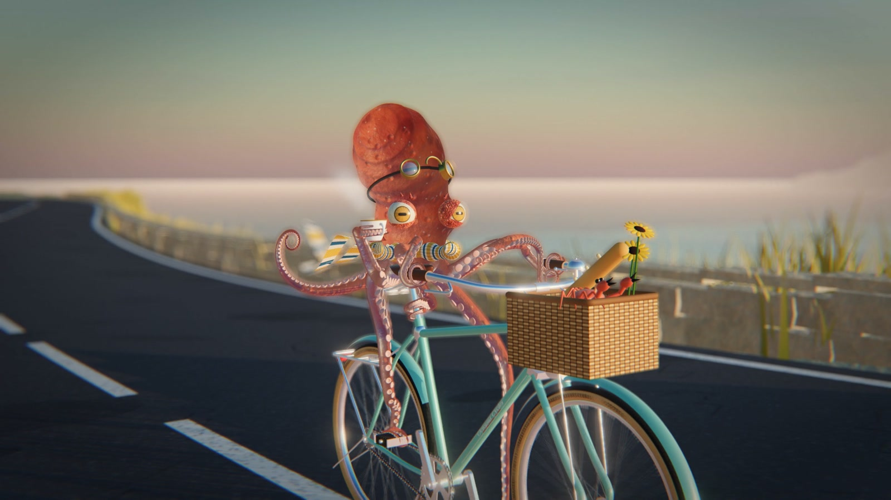
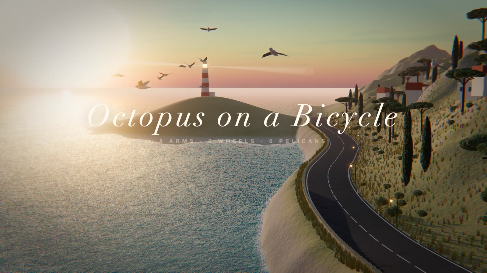
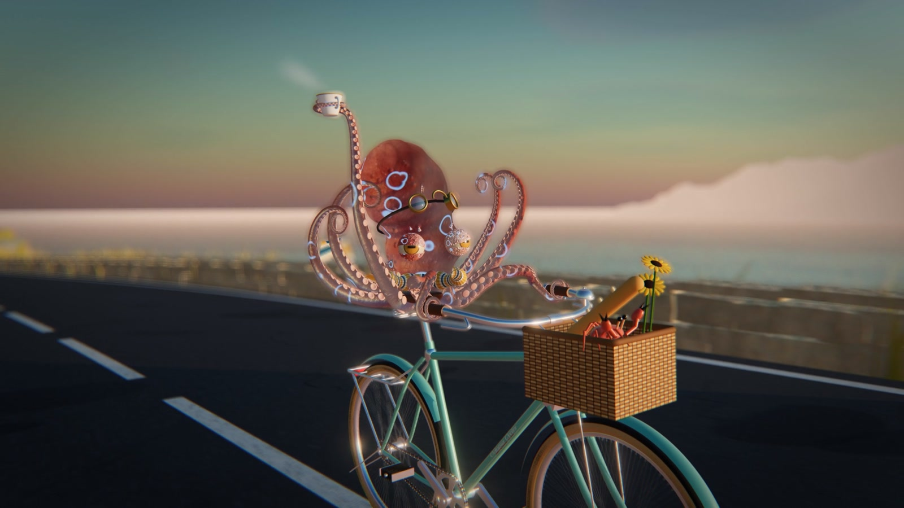

# Octopus on a Bicycle

A 34-second 3D short film where every spoke, chain link and sucker is code.

[Live demo](https://viton13bussiness-collab.github.io/octopus-on-a-bicycle/)  ·  [viton13.com](https://viton13.com)

<br>

An octopus in goggles and a knitted scarf rides a 28" Dutch roadster down a Mediterranean cliff road at golden hour, a shore crab navigating from the basket. There are no models, textures or footage files: the bicycle, the rider, the coast and the light are built procedurally in three.js and WebGL.

The film is a pure function of time — `seek(t)` renders any frame on its own — so the same page plays live in the browser and renders offline to 1080p60 with real sub-frame motion blur. The score and foley are synthesized in code too.

<br>

<table><tr><td></td><td></td></tr></table>

### Inside
- Eight procedural arms and about a thousand suckers
- Working bicycle: wheels, cranks, chain, freewheel, steering
- Cliff road, sea, Preetham sky, lighthouse, gulls
- Bloom, depth of field, colour grade, film-like fade
- Karplus–Strong and FM soundtrack, no licensed audio

### Run
```bash
npx serve .            # open the printed URL; ?t=12 holds one frame
npm install            # only for offline rendering (Chrome + ffmpeg)
npm run sound && npm run render
```

### Stack
three.js · WebGL · vanilla JS · Puppeteer · ffmpeg

<br>

---

<sub>Source-available, not open source. © 2025–2026 VITON13. Free for personal, study and non-profit use under <a href="LICENSE.md">PolyForm Noncommercial 1.0.0</a>. Commercial use needs a license — <a href="mailto:info@viton13.com">info@viton13.com</a> · <a href="COMMERCIAL.md">details</a>.</sub>

<sub>По-русски: «Осьминог на велосипеде» — 34-секундный 3D-фильм, целиком написанный кодом на three.js; коммерческое использование — только по договорённости.</sub>

<sub>Credits: three.js r186 (MIT, <a href="vendor/three/LICENSE">vendor/three</a>).</sub>
